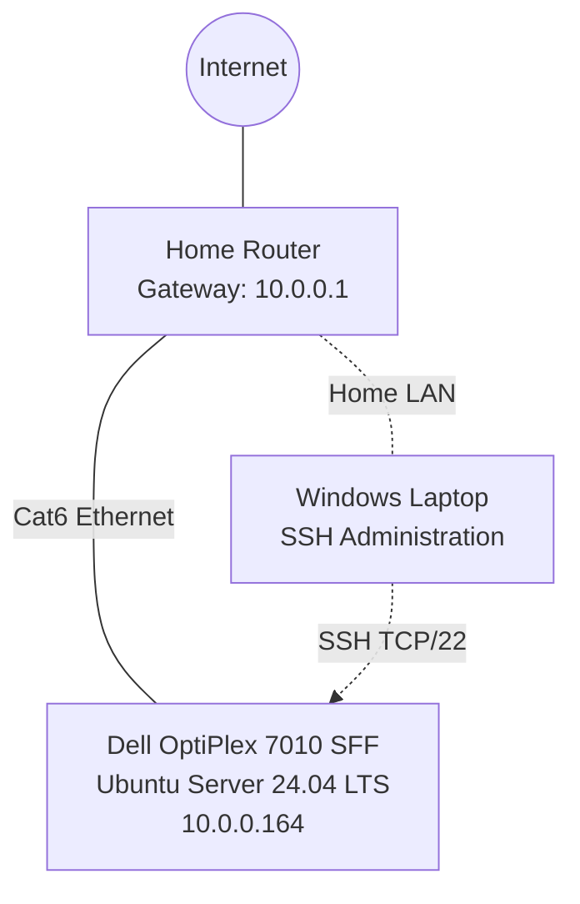
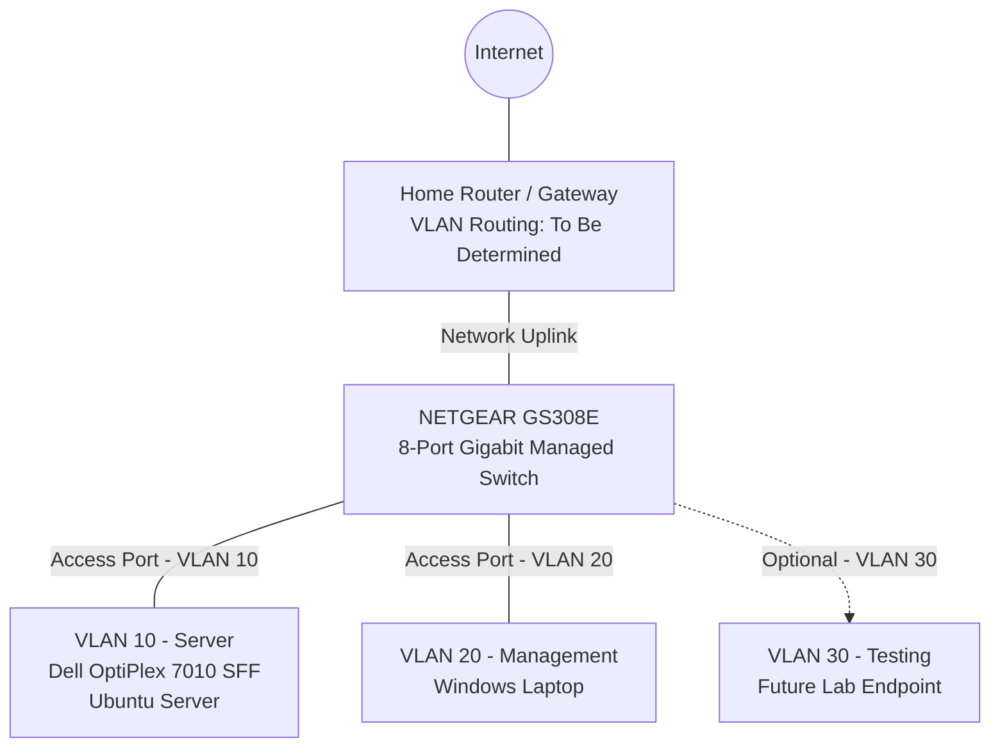

## Current Architecture

The current lab consists of a physical Ubuntu Server connected
to the home network through Gigabit Ethernet.

The server is remotely administered from a Windows laptop
using SSH.

### Current Configuration

| Component | Configuration |
|---|---|
| Server | Dell OptiPlex 7010 SFF |
| Operating System | Ubuntu Server 24.04 LTS |
| Memory | 10 GB DDR3 |
| Storage | Samsung 128 GB SSD |
| Network | Gigabit Ethernet |
| IP Address | 10.0.0.164/24 (DHCP) |
| Gateway | 10.0.0.1 |
| Remote Access | OpenSSH |

--- 

## Target Architecture

The planned architecture introduces a NETGEAR GS308E managed
switch to support VLAN configuration, network segmentation,
and additional infrastructure troubleshooting exercises.

### Planned Network Configuration

| VLAN | Purpose | Status |
|---|---|---|
| VLAN 10 | Server Infrastructure | Planned |
| VLAN 20 | Management | Planned |
| VLAN 30 | Network Testing | Optional |

### Planned Implementation

- [ ] Install secondary SSD.
- [ ] Integrate NETGEAR GS308E.
- [ ] Document switch port assignments.
- [ ] Configure VLAN membership.
- [ ] Test VLAN connectivity and isolation.
- [ ] Configure inter-VLAN routing if supported.
- [ ] Verify SSH access across the intended management path.
- [ ] Document final network configuration.

**Status:** Planned architecture. Configuration subject to hardware
capabilities and connectivity testing.
